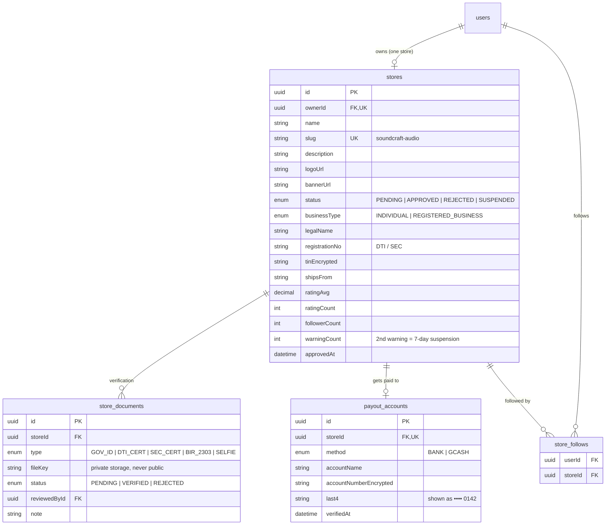
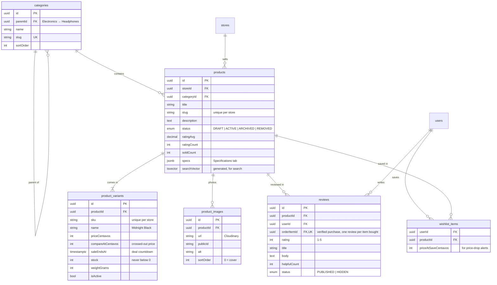
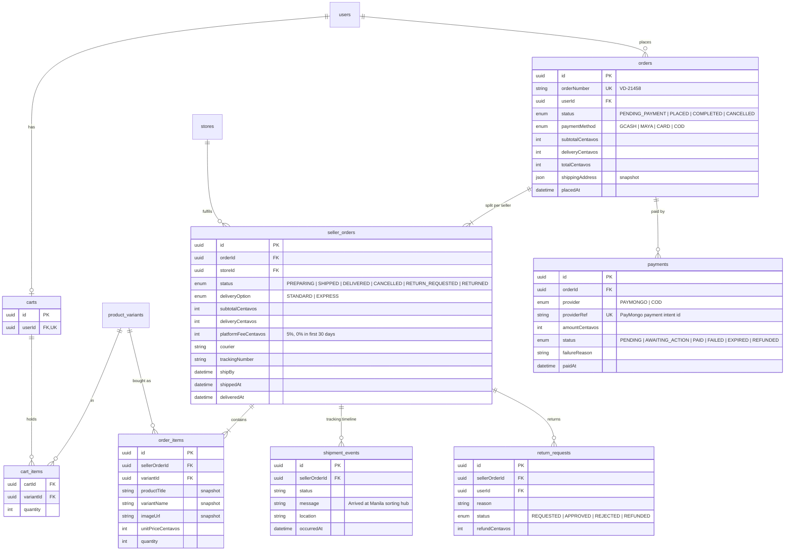
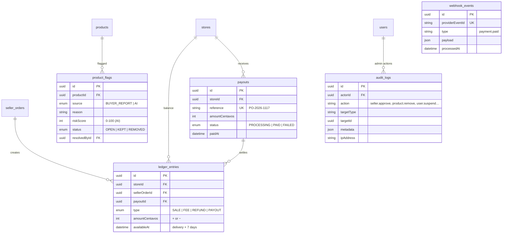

# Vendora database design (milestone 2, approved)

> Built in [`prisma/schema.prisma`](../prisma/schema.prisma), with the SQL in [`prisma/migrations`](../prisma/migrations).
>
> Small changes made while building, compared with the reviewed draft:
> - `orders.orderNumber` is an auto-increment number shown as `VD-` + number.
> - `seller_orders` gained the status `AWAITING_PAYMENT`, so sellers don't see unpaid orders.
> - `order_items` also stores `productId`.
> - `product_variants` also stores `storeId`, so a SKU can be unique per store.
> - `users.deletedAt` was added: accounts are anonymised, not deleted, because past orders must stay valid.
>
> The CHECK safety rules are listed at the end of the migration SQL.

PostgreSQL (Neon), accessed with Prisma. **31 tables in 5 areas (30 from milestone 2, plus `trusted_devices` added in milestone 3c), and 2 more for the AI assistant in milestone 8.** Short-lived security data (lockouts, rate limits, revoked tokens) lives in Redis, not here.
The diagrams use Mermaid: GitHub shows them as pictures, and in VS Code install the "Markdown Preview Mermaid Support" extension to see them.

## Ground rules

| Rule | Why |
|---|---|
| **Money is stored in centavos (whole numbers).** For example, ₱7,499 is stored as `749900`. | Decimal numbers can't represent some amounts exactly, so totals could be off by a centavo. Fees are rounded to the nearest peso, so the designs still show ₱500. |
| **IDs are UUID v7** (random, time-ordered). | IDs can't be guessed (no `/orders/1`, `/orders/2`, …) and new rows still sort by time. Shoppers see readable order numbers like `VD-21458`. These come from a counter that starts at 21000. The numbers are unique and increasing, but may skip a number when an order fails to save, which is normal in Postgres. |
| **Orders store copies (snapshots)** of the product name, price, photo and delivery address. | A receipt must not change when a seller edits a product later. |
| **Products are archived, never deleted.** | Old orders and reviews keep working. |
| **Secrets are only stored hashed or encrypted.** Passwords use Argon2id; refresh tokens are SHA-256 hashes; one-time codes and links are keyed hashes (HMAC-SHA256); tax IDs (TIN), payout account numbers and 2FA secrets are encrypted (AES-256-GCM). | A stolen database copy can't be used to log in or read private data (security checklist: "compromised database"). |
| **Every table has `createdAt`/`updatedAt`; foreign keys and filter columns have indexes.** | Fast lookups. After the first migration, the indexes will be checked in Postgres itself, because in Tooth Fairy one index silently failed to build. |

---

## 1 · Accounts & security

```mermaid
erDiagram
  users ||--o{ oauth_accounts : "signs in with"
  users ||--o{ sessions : "is signed in on"
  users ||--o{ auth_tokens : "receives"
  users ||--o{ backup_codes : "has"
  users ||--o{ trusted_devices : "skips 2FA on"
  users ||--o{ security_events : "history"
  users ||--o{ addresses : "ships to"
  users {
    uuid id PK
    string email UK "stored lowercase"
    datetime emailVerifiedAt "null = not verified"
    string passwordHash "Argon2id; null for Google-only"
    string name
    string phone "+63…"
    enum role "CUSTOMER | SELLER | ADMIN"
    enum status "ACTIVE | SUSPENDED"
    datetime passwordChangedAt "tokens issued before this are refused"
    string twoFactorSecret "AES-256-GCM, bound to the user id"
    datetime twoFactorEnabledAt "null = 2FA off (secret may be pending set-up)"
    datetime lastLoginAt
  }
  oauth_accounts {
    uuid id PK
    uuid userId FK
    enum provider "GOOGLE"
    string providerUserId "Google sub; unique with provider"
    string email "Connected as … (refreshed at sign-in)"
  }
  sessions {
    uuid id PK
    uuid userId FK
    string refreshTokenHash UK "SHA-256"
    uuid familyId "rotation chain: reuse of an old token revokes the chain"
    bool persistent "keep me signed in: 30 days, else ends with the browser"
    string userAgent
    string ipAddress
    string location "e.g. Manila, PH"
    datetime lastUsedAt
    datetime expiresAt
    datetime revokedAt
  }
  auth_tokens {
    uuid id PK
    uuid userId FK
    enum type "EMAIL_VERIFY | PASSWORD_RESET | EMAIL_CHANGE | REAUTH"
    string tokenHash UK "SHA-256"
    int attempts "max 5 wrong codes"
    datetime expiresAt "10 min code / 30 min link"
    datetime usedAt "single use"
  }
  backup_codes {
    uuid id PK
    uuid userId FK
    string codeHash "keyed hash (HMAC); 10 per user"
    datetime usedAt "single use"
  }
  trusted_devices {
    uuid id PK
    uuid userId FK
    string tokenHash UK "SHA-256 of the cookie token"
    datetime expiresAt "30 days"
    datetime revokedAt "password change/reset or 2FA off"
  }
  security_events {
    uuid id PK
    uuid userId FK
    enum type "LOGIN_OK | LOGIN_FAILED | LOCKED | PASSWORD_CHANGED | TWO_FA_ON | …"
    string ipAddress
    string userAgent
  }
  addresses {
    uuid id PK
    uuid userId FK
    string label "Home / Office"
    string fullName
    string phone
    string region "Metro Manila (NCR)"
    string province "null for NCR"
    string city
    string barangay
    string street
    string postalCode
    bool isDefault
  }
```

- **Signed-in devices** = `sessions` (one chain per device; `location` from the hosting provider's headers). "Sign out of all other devices" revokes every other session and their 2FA trust. A password change revokes all sessions and sets `passwordChangedAt`.
- **Google sign-in:** at most one Google account per Vendora account (`userId + provider` unique), and a Google account never serves two Vendora accounts (`provider + providerUserId` unique). Migration `20261119150000_google_sign_in`.
- **Two-step verification:** the authenticator secret is encrypted; backup codes are keyed hashes; "Trust this device for 30 days" = `trusted_devices` (cookie token hashed), all revoked by a password change/reset or turning 2FA off. Added in migration `20261119090000_two_factor_trusted_devices`.
- **Lockout counters, rate limits and revoked access tokens** are in Redis with automatic expiry. `security_events` keeps the history shown on the "Recent security activity" screen.

## 2 · Stores (sellers)

## 3 · Catalog

- **Search** (milestone 4a, migration `20261120090000_catalog_search`) runs inside PostgreSQL, with no extra search service:
  - `searchVector` is a **generated** `tsvector` column (title weight A, description weight B, `english` stemming), so PostgreSQL keeps it in step with every insert and edit. A GIN index makes `@@ websearch_to_tsquery(...)` fast.
  - Typos fall back to `pg_trgm` `word_similarity` on the title (GIN trigram index), only when the words match nothing. The extension is created by the migration.
  - Prisma can't describe generated columns, so the schema marks `searchVector` as `Unsupported("tsvector")` and the SQL is hand-written in the migration.
- **Specifications** (`specs`, JSONB): `[{ "label": "Battery life", "value": "30 hours" }]`. They're only shown, never filtered on, so a JSON list beats a separate table. CHECK: it's a list of at most 30.
- **Deal countdown** (`saleEndsAt`): after it, the variant sells at `compareAtCentavos` again, worked out when the price is read (TypeScript and SQL share one rule), so no job has to end deals. CHECK: a countdown needs a regular price to go back to.
- **Ratings** (milestone 4b): `ratingAvg`/`ratingCount` on products and stores are stored, because search filters and sorts by them, but never typed in. `recomputeRatings()` (`src/modules/reviews/ratings.ts`) rebuilds them from the PUBLISHED reviews whenever reviews change: the seed, writing, editing or deleting a review (milestone 5c, in the same transaction, with the store row locked so simultaneous reviews can't recompute from a stale count), hiding one or removing a product in milestone 7. A store counts all its products' reviews except products removed by moderation. "98% positive" (4–5★ in the last 12 months) is computed when read.
- **Follows**: `store_follows` has one row per shopper and store (primary key), and `stores.followerCount` is a counter kept in step in the same transaction. The counter moves only when a row was really inserted or deleted, so double clicks can't inflate it. The demo stores start from a demo number.
- **Tracking** (milestone 5c): a package's milestones are columns on `seller_orders` (`shippedAt` with `courier` and `trackingNumber`, `deliveredAt`, `cancelledAt`), set by the seller in milestone 6. `shipment_events` holds only the extra updates in between ("Arrived at Manila sorting hub · Pasay City"), so the timeline never lists a milestone twice.
- **Demo reviews** are real rows: 40 demo shoppers with delivered orders (`orders` → `seller_orders` → `order_items`), each review linked to its order item. The seed replaces only those shoppers' orders and reviews.
- **Wishlist** (milestone 4c): one row per shopper and product (primary key), with `priceAtSaveCentavos` = the price when saved, kept on re-save. A price drop is today's effective price below it, worked out when read. Rows stay when a product stops being sold (shown as unavailable); they go when the shopper removes them or the account is deleted (cascade).

## 4 · Cart, orders & payments

- **One checkout = one `order`, split into one `seller_order` per store.** Each seller ships, tracks and gets paid separately, which is the "3 packages" on the confirmation screen.
- **Cart and addresses** (milestone 5a, migration `20261121090000_cart_addresses`): `cart_items.priceAtAddCentavos` remembers the price the shopper last saw ("Price changed since you added it"). Addresses are stored in Philippine formats (CHECK: mobile `+639XXXXXXXXX`, 4-digit postal code) with one default per shopper (a partial unique index, `WHERE "isDefault"`).
- **Stock can't oversell.** Placing an order takes stock with one atomic update (`stock = stock − qty` only if enough is left), all inside one transaction with the order. A failed or expired payment (15 min) puts the stock back.
- **Checkout** (milestone 5b, migration `20261122090000_checkout_payments`): `orders.idempotencyKey` is unique per shopper, so "Place order" sent twice can only create one order. Each PayMongo attempt is a `payments` row: `providerRef` = the checkout session (`cs_…`), `providerPaymentId` = the payment that settled it (`pay_…`, used for refunds), `checkoutUrl` = PayMongo's page. An unpaid online order holds its stock until `expiresAt` (15 minutes, stretched while PayMongo is mid-payment, at most 45).
- **`webhook_events`** (below) stores every PayMongo event ID once, so a repeated webhook can't mark an order paid twice.

## 5 · Seller money & admin

- **A seller's balance is the sum of their ledger entries,** not a number that gets overwritten. Every peso can be traced to an order, fee, refund or payout, the way accounting systems do it.
  - Example: a ₱9,998 sale (+999800), the fee (−50000), and later a payout (−949800).
- **Admin actions always write an `audit_logs` row.** That's what the "audit-logged" note on the admin AI panel refers to.

## 6 · AI assistant (milestone 8)

`ai_conversations` (user, scope SHOPPER/SELLER/ADMIN) and `ai_messages` (role, content, tool calls, tokens used). They're designed now but created in milestone 8.

## What lives in Redis instead

| Key | Expires |
|---|---|
| Rate-limit counters | 15 min window |
| Failed sign-ins per account + per IP → lockout | 15 min |
| Revoked access-token IDs (after sign-out / password change) | when the token would expire (15 min) |
| Half-finished sign-ins ("enter your 2FA code" / "set up 2FA") | 5 min / 15 min |
| Authenticator codes already used (replay protection) | 2 min |
| "Confirm it's you" done on a sign-in chain (device) | 10 min |
| Product/category cache (milestone 4) | minutes |
